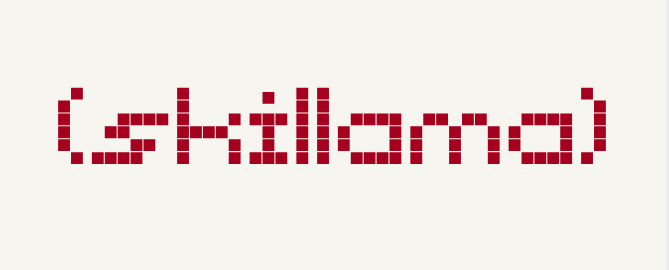

<p align="center">
  
</p>

<h1 align="center">skillama-api</h1>

<p align="center">
  A Claude Code skill: <b>Ollama Cloud API reference for LLM agents</b>.
</p>

---

## Why

Most LLMs were trained when Ollama was **local-only** — their knowledge cuts off before
Ollama offered cloud models (`https://ollama.com`). Agents therefore routinely write Ollama
code with wrong endpoints, wrong auth, or wrong model naming. This skill fixes that: a
compact, fact-checked reference an agent can read before writing or debugging code that
calls Ollama — especially Ollama Cloud.

## What's inside

```
skillama-api/
├── SKILL.md                      # core facts + quickstart (loaded into context on invoke)
└── references/                   # read on demand
    ├── native-api.md             # /api/chat, /api/generate, /api/embed, NDJSON streaming,
    │                             # thinking (`think`, `message.thinking`), tool calling
    ├── compat-openai.md          # OpenAI-compatible /v1 — supported/unsupported fields,
    │                             # reasoning-effort mapping, /v1/responses limits
    ├── compat-anthropic.md       # /v1/messages — Bearer auth (NOT x-api-key), SSE events,
    │                             # supported/unsupported features
    ├── account-and-tools.md      # /api/balance, /api/usage, /api/web_search, /api/web_fetch,
    │                             # error codes, rate limits
    └── models.md                 # cloud model catalog: names, capabilities, typical use cases
```

## Key facts the skill teaches

- **Cloud = direct HTTP** to `https://ollama.com/{api,v1}` with
  `Authorization: Bearer $OLLAMA_API_KEY` — no local Ollama install, no pull step.
  Key: https://ollama.com/settings/keys
- **Three compatible APIs**: native (`/api/...`), OpenAI-style (`/v1/chat/completions`, …),
  Anthropic-style (`/v1/messages`).
- **Model naming differs by path**: direct API → `gemma4:31b` (names from `GET /api/tags`);
  CLI/app via a signed-in local server → `gemma4:cloud`.
- Anthropic SDK on cloud needs `auth_token` (Bearer) — **`x-api-key` is not accepted**.
- Native endpoints **stream NDJSON by default**; disable with `"stream": false`.
- **Structured outputs (JSON schema) are not supported on cloud** — prompt for JSON instead.
- Errors: JSON `{"error": "..."}`; 429 carries `Retry-After`; mid-stream errors arrive as an
  NDJSON line without changing the HTTP status.

## Install

```bash
ln -sfn /path/to/skillama-api ~/.claude/skills/skillama-api
# or copy: cp -r skillama-api ~/.claude/skills/
```

For a project instead of a user install: move it to `<project>/.claude/skills/skillama-api`.

## Usage

Agents get the skill automatically (it triggers on Ollama-related coding tasks), or you can
invoke it directly in Claude Code:

```
/skillama-api
```

**Verified end-to-end** (2026-11-07): a fresh agent invoked the skill, read
`SKILL.md` + 3 references, and wrote a working program against the live API —
see the demo program `agent_test.py` (in `skillama-api-demo/` next to this repo)
for an example of what an agent produces from this skill alone.

## Keeping it accurate

The model list and docs drift. The skill instructs agents to:

- verify against https://docs.ollama.com (index: https://docs.ollama.com/llms.txt)
- fetch live model names via `GET https://ollama.com/api/tags`
- check usage/balance limits at https://ollama.com/pricing
